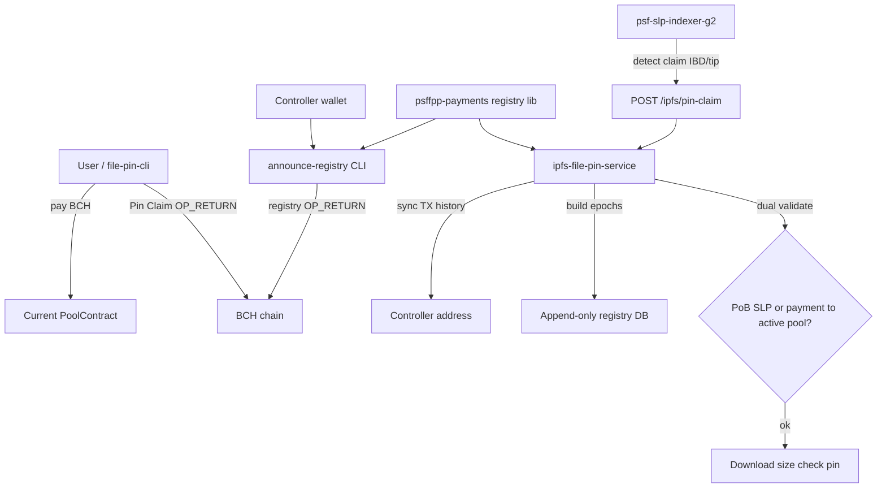

# PSFFPP Infra Changes (CashScript payments)

Agent handoff plan for integrating CashScript pool payments with PSFFPP: indexer, pin-service, shared registry lib/CLIs, and client tooling.

**Verdict on earlier drafts:** architecture alone (dual-mode validation + pin-service-owned registry) is not enough to build end-to-end. This document freezes protocol bytes, names exact repos/packages/CLIs, and lists validation/API edge cases implementers must not invent ad hoc.

## Locked design decisions

- **Pool address rotation** is expected; historical validation answers: at claim height H, was A a legitimate Pool, and did `paymentTxid` send ≥ required sats to A?
- **Registry:** trusted **controller address** posts append-only OP_RETURN updates; pin-service syncs them by **pulling controller TX history**. Multisig later.
- **Bootstrap:** `POOL_REGISTRY_CONTROLLER` (cashaddr) in pin-service config — only spends from that address may update the registry.
- **Pricing:** each registry announcement bakes **`satsPerMb`** (target ~$0.01/MB at announcement time). Claims in an epoch use that epoch’s rate — no live oracle on validation/sync.
- **Claims:** reuse existing Pin Claim OP_RETURN; first TXID field is legacy PoB **or** BCH `paymentTxid`. Pin-service **dual-detects**.
- **Registry ownership:** **ipfs-file-pin-service** (not the indexer).
- **Shared encode/decode:** live in **psffpp-payments** (imported by pin-service and CLIs) so announcer and validator never diverge.



---

## Handoff checklist (what a fresh agent must build)

| # | Deliverable | Repo |
|---|-------------|------|
| 1 | Frozen registry OP_RETURN encode/decode + fixtures | `psffpp-payments` |
| 2 | CLI: `announce-registry` (controller signs/broadcasts) | `psffpp-payments` |
| 3 | CLI helpers: compute `satsPerMb` from USD+BCH spot (ops convenience only; not used at validation) | `psffpp-payments` |
| 4 | Pin-service: registry sync, Mongo epochs, dual validation, payment-address API | `ipfs-file-pin-service` |
| 5 | Indexer: docs/comments only (claim field semantics) | `psf-slp-indexer-g2` |
| 6 | Client: BCH pay+claim path in `file-pin-cli` (and/or `psffpp` npm) | `file-pin-cli` / `psffpp` |
| 7 | This document + README link | `psffpp-payments` |

Related repos (typical local paths):

- [`psffpp-payments`](../) (this repo)
- [`ipfs-file-pin-service`](../../ipfs/ipfs-file-pin-service)
- [`psf-slp-indexer-g2`](../../slp/psf-slp-indexer-g2)
- [`file-pin-cli`](../../ipfs/file-pin-cli)

---

## Protocol: Pool registry OP_RETURN (frozen)

Lokad ASCII **`PSP1`** (PSFFPP Pool registry v1). Match existing Pin Claim style: OP_RETURN + 4-byte push of lokad.

**scriptPubKey ASM (vout[0]):**

```text
OP_RETURN
OP_PUSHDATA 50535031          # "PSP1"
OP_PUSHDATA 01                # version = 1 (1 byte)
OP_PUSHDATA <poolCashAddrUtf8>
OP_PUSHDATA <validFromHeightLE8>
OP_PUSHDATA <satsPerMbLE8>
OP_PUSHDATA <prevRegistryTxidBin32>
```

**Field rules (do not reinterpret):**

| Field | Bytes | Encoding | Notes |
|-------|-------|----------|-------|
| lokad | 4 | `PSP1` = `50 53 50 31` | Detect: OP_RETURN hex contains `6a0450535031` (same pattern as pin claim `6a0400510000`) |
| version | 1 | `0x01` | Reject unknown versions |
| poolCashAddr | variable | UTF-8 cashaddr **with** `bitcoincash:` prefix, P2SH32 pool deposit address from deploy record | No token-aware address |
| validFromHeight | 8 | **uint64 little-endian** block height | Inclusive; use 8 bytes even if height fits in 4 |
| satsPerMb | 8 | **uint64 little-endian** satoshis per megabyte | Required rate for claims while epoch active |
| prevRegistryTxid | 32 | raw txid bytes in **Bitcoin internal byte order** (same as typically displayed hex reversed vs explorer — implementers: encode/decode with tests against a known fixture hex) | Genesis: 32 zero bytes |

**Detection code path:** same approach as `isPinClaim` in `psf-slp-indexer-g2` (`src/adapters/transaction.js`): read `vout[0].scriptPubKey.hex`, check prefix/includes `6a0450535031`, then `Script.toASM` + split pushes.

**Auth rule:** accept a registry TX only if the **first vin’s prevout address** equals configured `POOL_REGISTRY_CONTROLLER` (normalized cashaddr). Do not accept “controller somewhere later in vin list” for v1.

**Chain rule:** `prevRegistryTxid` must equal the previous accepted announcement’s txid (or 32 zero bytes if DB empty / genesis). Reject if tip already has a different child (no forks).

**Epoch interval:** for announcement i with height H_i, address A_i is valid for claims with `claimTx.height` in `[H_i, H_{i+1})`. Latest epoch: `[H_latest, +∞)`.

**Config seed (allowed):** if Mongo empty, pin-service may insert one synthetic genesis epoch from env (`POOL_REGISTRY_SEED_*`) with `registryTxid = "seed"`, `prevRegistryTxid = 00…00`. Prefer **on-chain-only** for production; seed is ops bootstrap for `GET /payment-address` before the first announce. On first successful on-chain sync, treat on-chain tip as authoritative for subsequent validation.

**Shared library location:** `psffpp-payments/lib/pool-registry/` (or `src/pool-registry/`):

- `encodeAnnouncement({ poolCashAddr, validFromHeight, satsPerMb, prevRegistryTxid }) → hex script / outputs`
- `decodeAnnouncement(opReturnHexOrAsm) → fields | null`
- `requiredSats({ fileSizeBytes, satsPerMb }) → ceil(fileSizeBytes / 1e6 * satsPerMb)`
- Unit tests with **fixture vectors** in `psffpp-payments/test/fixtures/registry-opreturn.json`

Pin-service and announce CLI **must** import this lib (path dependency or published workspace package) — do not reimplement decode in pin-service.

---

## `psffpp-payments` CLIs and ops tooling (new)

Contracts already exist; operators still need:

| Script | Purpose |
|--------|---------|
| `scripts/announce-registry.mjs` | Load controller WIF from env (never commit); build PSP1 OP_RETURN + dust+fee inputs; broadcast; print txid + decoded fields |
| `scripts/compute-sats-per-mb.mjs` | Ops helper: inputs USD/MB (default 0.01) + BCH/USD → integer `satsPerMb` (round **up**) |
| Existing `deploy.mjs` / `addresses.mjs` | Unchanged; announce consumes `poolAddress` from deployment JSON |

**Deploy epoch** = compile/instantiate pool → `compute-sats-per-mb` → `announce-registry` → confirm pin-service `GET /ipfs/payment-address`.

---

## `psf-slp-indexer-g2` changes (minimal)

| Item | Action |
|------|--------|
| `src/adapters/transaction.js` `isPinClaim` | **No decode change.** Comment that `proofOfBurnTxid` may be BCH payment txid **or** legacy PoB. Webhook JSON key stays `proofOfBurnTxid`. |
| `src/adapters/webhook.js` | No change. |
| `src/use-cases/index-blocks.js` | No change to IBD webhook replay. |
| Docs / README | Dual-validation lives in pin-service; indexer does not parse PSP1. |

**Non-goals:** index registry OP_RETURNs; validate payments; expose pool address.

---

## `ipfs-file-pin-service` changes (primary)

### Config (`config/env/common.js`)

- `POOL_REGISTRY_CONTROLLER` (required for BCH path)
- `ACCEPT_BCH_POOL_PAYMENT` (default true when controller set)
- `ACCEPT_LEGACY_PSF_POB` (default true)
- Optional seed: `POOL_REGISTRY_SEED_ADDRESS`, `POOL_REGISTRY_SEED_VALID_FROM`, `POOL_REGISTRY_SEED_SATS_PER_MB`
- `POOL_REGISTRY_SYNC_MS` — timer interval for controller history refresh
- Optional `POOL_REGISTRY_HISTORY_FROM` — block height floor when paging controller history

### Registry adapter + Mongo

- Model fields: `registryTxid`, `poolAddress`, `validFromHeight`, `satsPerMb`, `prevRegistryTxid`, `controllerAddress`, `height` (block height of announcement TX if known), `createdAt`
- `syncFromController()` using the same wallet stack already used for `getTxData` (minimal-slp-wallet / psf-bch-api): page controller address history, decode PSP1 via shared lib, verify controller + chain link, upsert sorted by `validFromHeight`
- Refresh on boot, timer, and once before BCH validation if last sync older than N seconds
- `getEpochAtHeight(H)`, `getCurrentEpoch()`

Follow existing in-repo patterns for `getTxData` / address history — do not invent a new blockchain client.

### Dual validation (`src/use-cases/ipfs.js`)

Keep webhook field name `proofOfBurnTxid`.

1. Fetch payment/PoB TX + claim TX (existing).
2. If `ACCEPT_LEGACY_PSF_POB` and valid SLP + PSF token ID → legacy `_getTokenQtyDiff`; `paymentKind: 'psf-pob'`.
3. Else if `ACCEPT_BCH_POOL_PAYMENT`:
   - Resolve epoch at `claimTxDetails.height`. **Default: require confirmed claim height** for BCH path (reject unconfirmed claims for BCH payments).
   - Sum `vout[i].value` (sats) where output address **normalizes equal** to `epoch.poolAddress` (use libauth/cashaddr canonicalize; compare P2SH32 payload, not display string alone).
   - **Multiple outputs to pool count**; change to other addresses ignored.
   - `satsPaid = sum`; `paymentKind: 'bch-pool'`.
4. Else reject.

`validateSizeAndPayment`:

- Legacy: unchanged PSF write-price × MB × 0.98.
- BCH: `required = requiredSats({ fileSizeBytes, satsPerMb: epoch.satsPerMb })` from shared lib; pass if `satsPaid >= floor(required * 0.98)` (same tolerance spirit as legacy).

### Payment matching edge cases (must implement)

- Wrong epoch address at height H → fail.
- Payment txid reuse across claims → follow existing `handleRenewal` / TXID-keyed semantics (do not invent a new reuse policy).
- Payment amount sufficient but claim height before `validFromHeight` → fail.
- Controller history pagination gaps → sync must paginate to genesis of controller or `POOL_REGISTRY_HISTORY_FROM`.
- Address format: canonicalize carefully; never require token-cashaddr.

### Persistence (`src/adapters/localdb/models/pins.js`)

Add `paymentKind`, `satsPaid`, `poolAddress`; keep `proofOfBurnTxid`, `tokensBurned`.

### REST

- `GET /ipfs/payment-address` → current epoch `{ address, validFromHeight, satsPerMb, registryTxid }`
- `GET /ipfs/pool-registry` → full append-only list (ops)
- `POST /ipfs/pin-claim` wire format unchanged

### Docs + tests

- Update `dev-docs/pin-claim-processing.md` for dual path, registry sync, BCH size check.
- Unit tests: decode fixtures, epoch boundaries, dual paths, insufficient sats, wrong pool.

---

## Client / `file-pin-cli` (and `psffpp`) changes

Today `pin-claim-file.js` uploads, burns PSF via `psffpp`, posts claim. Add a **BCH payment mode** (flag or default when payment-address API is available):

1. `GET {pinService}/ipfs/payment-address`
2. Compute required sats from file size + returned `satsPerMb` (prefer API values over local guess)
3. Send BCH to `address` (reuse `send-bch.js` patterns)
4. Build existing Pin Claim OP_RETURN with **payment txid** in the first field (same encoding as today’s PoB txid field)
5. Notify `POST /ipfs/pin-claim` as today

Keep legacy PSF burn path behind a flag during dual-mode.

If burn/claim construction lives mainly in npm `psffpp`, update that package similarly and bump the CLI dependency — locate burn helpers inside `psffpp` before duplicating OP_RETURN builders.

---

## Operator workflow (end-to-end)

1. `psffpp-payments`: deploy Pool+Shares → deployment JSON with `poolAddress`.
2. `compute-sats-per-mb` → integer rate.
3. `announce-registry` from controller wallet (link previous tip).
4. Pin-service syncs → `GET /ipfs/payment-address` matches.
5. User/CLI pays pool and claims with payment txid.
6. Indexer webhooks; pin-service dual-validates and pins.
7. Next epoch: new deploy + new announce; historical claims still validate via registry history.

## Genesis / late-sync

Indexer IBD still replays all Pin Claim webhooks. Pin-service syncs **full controller TX history** before/during BCH validation so month-old pool addresses resolve. The payment-address API is never the source of truth for historical checks.

---

## Out of scope

- CashScript cron/GUI; redesigning Pool to avoid address rotation
- Indexer webhook retry queue
- Multisig controller (note as future)
- Live USD/BCH oracle at claim validation time
- Formal PS010 spec merge (recommend follow-up PR)

## Implementation order

1. Freeze fixtures in `psffpp-payments` (this doc already freezes the byte layout)
2. Shared registry encode/decode lib + unit fixtures
3. `announce-registry` + `compute-sats-per-mb` CLIs
4. Pin-service registry sync + APIs + dual validation
5. Indexer doc/comment touch-up
6. `file-pin-cli` / `psffpp` BCH pay+claim path
7. Integration smoke: announce → pay → claim → webhook → pin

## Confidence bar for handoff

A fresh agent with this doc + access to the four repos should **not** need to invent: lokad bytes, integer encodings, which repo owns decode, how clients pay, or how late sync finds old pool addresses. Remaining judgment calls (exact wallet history API method names on minimal-slp-wallet) should be resolved by reading existing pin-service wallet usage — follow `getTxData` / address history patterns already used in-repo.
