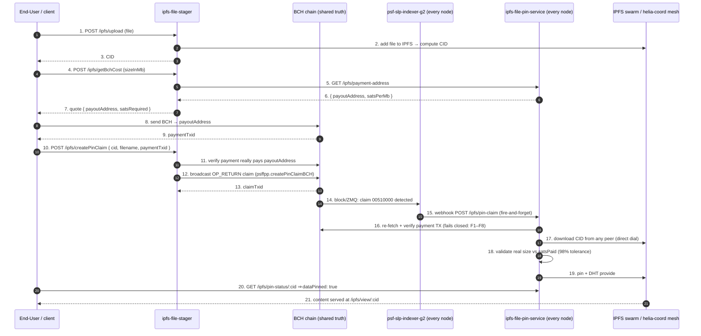
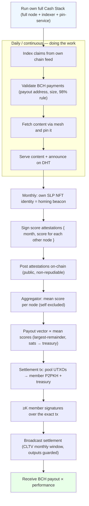
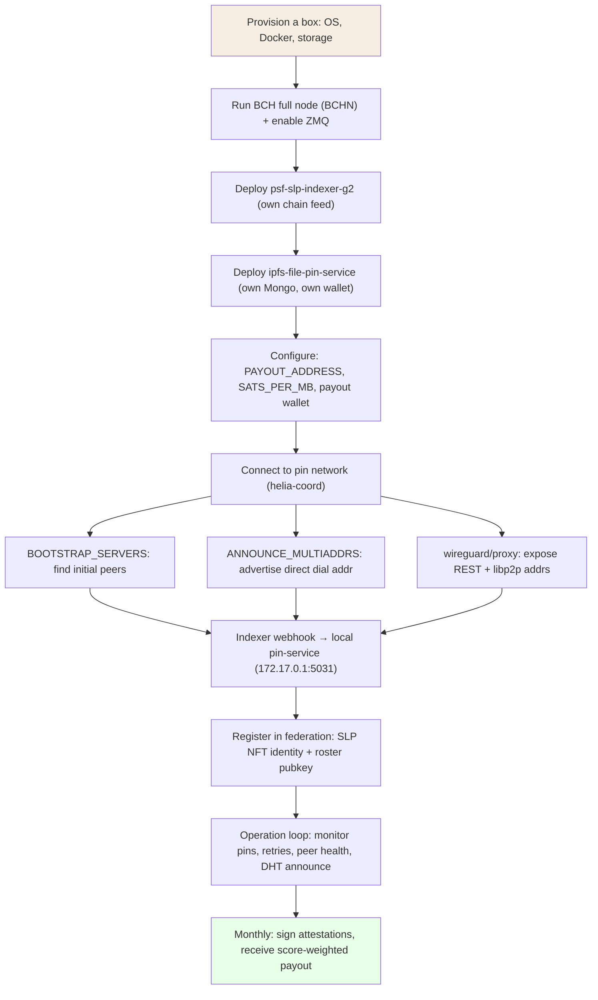

# Workflow diagrams — file pinning from three stakeholder perspectives

> **Status: DRAFT** — companion to [performance-weighted-payouts.md](
> performance-weighted-payouts.md). These Mermaid diagrams describe the same
> process from three different points of view: the end user who wants a file
> hosted, the node runner who wants a payout, and the operator who deploys and
> runs the infrastructure. Rendered natively by GitHub / GitLab / VS Code on any
> Markdown view; export to PNG/SVG with `mmdc` (mermaid-cli) if an image is
> needed elsewhere.

## System map (shared vocabulary)

Every network node is an operator's own full Cash Stack:

```
┌─────────────────────────── operator's box ───────────────────────────┐
│  BCH full node (BCHN) + ZMQ ──▶ psf-slp-indexer-g2                    │
│                                        │ webhook (local, 172.17.0.1)  │
│                                        ▼                              │
│  MongoDB ◀──── ipfs-file-pin-service ──▶ Helia/libp2p (helia-coord)    │
│                                        │                              │
│  payoutAddress / satsPerMb             │  libp2p content mesh         │
└────────────────────────────────────────┼──────────────────────────────┘
                                          │ peers: fetch content from each other
                                BCH blockchain (public, shared truth)
```

- One operator's outage never affects another node's ability to index, validate,
  or pin: each node reads the chain from **its own** full node and serves claims
  to **its own** local pin-service.
- The only node-to-node interaction is the **libp2p content mesh** (fetching
  file bytes from peers) and the **public BCH chain** (shared source of truth
  for payments and claims). Both are already decentralized.

---

## Diagram 1 — End-User perspective: "I want this file hosted"



Read: the user **pays once**, the claim is **broadcast once**, and every node's
indexer+pin-service pair independently repeats steps 14–19. That repetition — N
times over — is what produces N redundant copies and "collectively pin content".

---

## Diagram 2 — Node-runner perspective: "I want a payout for running a node"



Read: the node runner's payout is **proportional to attested performance**, where
the attestations cite objective, publicly verifiable facts (files pinned, bytes
served, uptime) — not vibes. Collusion is capped: the pool is fixed by real user
payments, so "everyone scores everyone high" converges to an equal split and mints
nothing.

---

## Diagram 3 — Operator perspective: "I'm setting up one node of the network"



Read: everything this node needs is **on the operator's own box** — full node,
ZMQ, indexer, pin-service, Mongo, wallet. No other operator's uptime, indexer, or
API key is required. Independence is the failure-resilience property; the mesh
and the chain are the only cross-operator surfaces.

---

## Rendering notes

- **Mermaid** (text-in-repo) is the primary format: versionable, diffable, and
  rendered natively by GitHub/GitLab/VS Code with zero tooling.
- To export PNG/SVG/images for external docs or chat, render locally:

  ```
  npx -y @mermaid-js/mermaid-cli -i docs/workflow-diagrams.md -o out.png
  ```

- Pair each diagram with a one-line "read:" note (above) so reviewers understand
  which property each workflow exists to guarantee.
